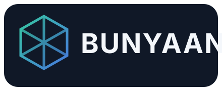
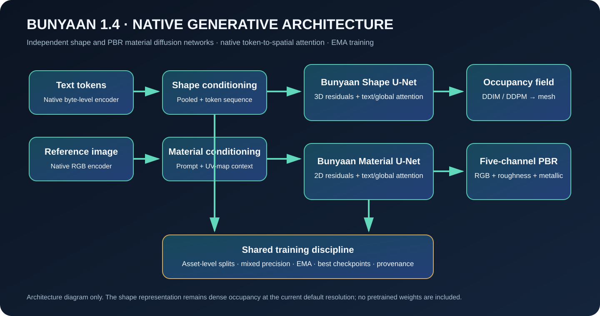
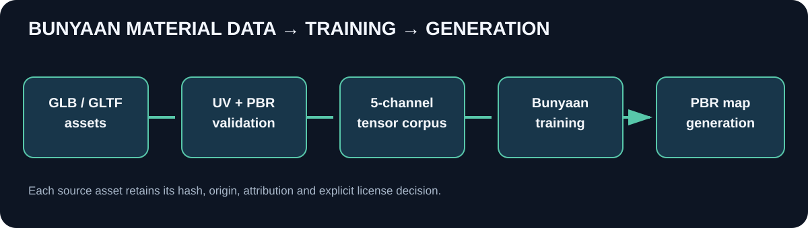

# Bunyaan — Independent Generative 3D Model

<p align="center">
  
</p>

<p align="center"><strong>Build worlds. Shape matter. Create materials.</strong></p>

<p align="center">
  
  
  
  
</p>

**Bunyaan is an independent, open-source generative 3D and PBR research project. v1.4 strengthens its native shape and material denoisers with token-to-spatial cross-attention, factorized linear global attention, EMA training, asset-level validation and deterministic DDIM inference.** Its model code, conditioning modules, diffusion processes, training loops, dataset tooling, inference interfaces and checkpoint formats are maintained as Bunyaan-native components. Bunyaan does not wrap, import, launch, or require another 3D foundation model.

> **Model maturity:** This repository provides trainable native architectures and reproducible engineering pipelines. It does not ship pretrained weights or claim production-grade generation quality. The quality of generated assets depends on training data, compute, model scale and evaluation. A successful software test is not evidence of foundation-model quality.

## Project at a glance

| Area | Bunyaan-native capability | Current boundary |
|---|---|---|
| 3D shape | Text/image conditioning, multi-scale 3D diffusion U-Net, token-to-spatial cross-attention, EMA, DDIM/DDPM sampling | Dense occupancy representation; default 32³, not yet a high-resolution latent/SDF generator |
| Materials | Conditional five-channel texture diffusion with token-to-spatial attention, deeper bottleneck and EMA inference | Requires UV-aligned licensed training corpus and trained weights; normal/AO are not learned channels |
| Asset ingestion | GLB/GLTF geometry, UVs, PBR material and texture extraction | Input quality and glTF feature coverage vary |
| Validation | UV presence/range/finite checks, overlap diagnostics, texture decode and resolution checks | Overlap is a diagnostic; no automatic UV unwrapping or repair |
| Training | Asset-level validation splits, AMP where supported, EMA validation, best/latest checkpoints, resume and JSONL logs | Scale and convergence depend on hardware and corpus |
| Export | OBJ/PLY and GLB/GLTF/STL through supported libraries | Export support follows installed dependency capabilities |

## v1.4 architecture upgrade

See [`docs/ARCHITECTURE-v1.4.md`](docs/ARCHITECTURE-v1.4.md), [`docs/BENCHMARKING.md`](docs/BENCHMARKING.md), [`docs/VERIFICATION-v1.4.md`](docs/VERIFICATION-v1.4.md) and [`UPGRADE-NOTES-v1.4.md`](UPGRADE-NOTES-v1.4.md) for the exact changes and limitations. The upgrade improves native conditioning and training stability; it does not establish superiority over other generators.

## Visual overview

<p align="center">
  
</p>

<p align="center">
  
</p>

## What is inside

```text
Bunyaan/
├── README.md                    # Project overview
├── README.<locale>.md           # Localized project guides (15 languages total)
├── LICENSE                      # Apache-2.0
├── Bunyaan-Core/
│   ├── bunyaan_model/            # Native 3D and PBR model code
│   ├── training/                 # Train, resume and evaluate
│   ├── tools/                    # Generation, GLB ingestion and validation
│   ├── datasets/texverse/        # Manifest and corpus documentation
│   ├── configs/                  # Versioned model configurations
│   ├── tests/                    # Automated tests
│   └── docs/                     # Model card, architecture and guides
└── docs/media/                   # Project diagrams and identity assets
```

No Hunyuan3D, TRELLIS, or other third-party model source tree is bundled in this distribution. Standard software libraries (for example PyTorch, NumPy, Pillow and trimesh) remain dependencies and retain their own licenses. They are not substitute generative models.

## Model families

### Bunyaan 3D

The native 3D path maps a text prompt and optional reference image into a conditioning representation, then predicts diffusion noise over a continuous occupancy volume. Sampling produces an occupancy field; an isosurface extraction step converts that field into a mesh for export.

**Current components:** native byte-token text conditioner; native image CNN conditioner; timestep embedding; conditional 3D U-Net with residual feature modulation; DDPM schedule and sampler; mesh extraction and export utilities.

### Bunyaan Material

The native material path learns UV-space physically based material maps. Its five output channels are ordered **R, G, B, roughness, metallic** and normalized to `[0, 1]`. The conditional denoiser uses Bunyaan's own text-conditioning and 2D convolutional encoder/decoder blocks.

Generated material maps can be exported as base-colour, roughness and metallic images. Normal and ambient-occlusion maps, where produced by helper utilities, are derived outputs and should not be mistaken for independently learned channels.

## TexVerse-compatible ingestion

The ingestion tools accept GLB/GLTF assets and extract geometry, UV coordinates, material factors and referenced textures. Validation records missing UV attributes, non-finite and out-of-range coordinates, likely UV overlaps, unreadable textures and unsuitable source dimensions. Corpus preparation writes normalized five-channel training tensors and records source hashes, asset identifiers, source URLs where supplied, attribution and license metadata.

**Rights are not inferred from availability.** Only include assets whose license or written permission explicitly allows the intended machine-learning training and redistribution. Preserve source license text and attribution. An unknown or ambiguous license must be treated as not approved. TexVerse metadata or a manifest does not itself grant rights to download, train on, or redistribute an asset.

See [`Bunyaan-Core/datasets/texverse/TRAINING-PIPELINE.md`](Bunyaan-Core/datasets/texverse/TRAINING-PIPELINE.md).

## Installation

Use Python 3.10–3.12. Install a PyTorch build appropriate for your CPU or CUDA environment, then install the project dependencies:

```bash
cd Bunyaan-Core
python -m venv .venv
# Windows: .venv\\Scripts\\activate
# macOS/Linux: source .venv/bin/activate
python -m pip install --upgrade pip
pip install -r requirements.txt
```

CUDA is recommended for model training. CPU mode is useful for tests and small experiments but can be slow. Optional mesh export and inspection features depend on the installed packages and file formats.

## Quick start

### 1. Inspect and ingest licensed GLB assets

```bash
python tools/extract_texverse.py --help
python tools/validate_texverse.py --help
```

Use the extractor's `--input`, `--out`, `--manifest` and resolution options shown by `--help` for the version in this checkout. Review validation reports before training; do not silently accept assets with missing UVs, unreadable maps or unclear rights.

### 2. Train Bunyaan Material

```bash
python training/train_texture.py --help
```

The trainer supports reproducible model-level train/validation separation, mixed precision when supported by the selected device, periodic/latest and best-validation checkpoints, resume and JSONL experiment logs. Start with a small verified corpus and confirm tensor semantics before scaling up.

### 3. Evaluate a material checkpoint

```bash
python training/evaluate_texture.py --help
```

Use a held-out split that was not used for gradient updates or model selection. Report per-channel errors and denoising metrics. Quantitative denoising loss alone does not establish visual quality, material plausibility or generalization.

### 4. Train and evaluate Bunyaan 3D

```bash
python tools/prepare_mesh_dataset.py --help
python training/train.py --help
python training/evaluate.py --help
```

The 3D training dataset currently uses captioned mesh-to-occupancy examples. Image-conditioned generation requires paired image/shape examples; a reference image passed at inference does not make an untrained image-conditioning pathway useful.

### 5. Generate with a trained Bunyaan checkpoint

```bash
python tools/generate.py --help
```

Shape inference defaults to deterministic DDIM with 50 steps; select `--sampler ddpm` for the ancestral sampler. Use `--guidance` and `--steps` to control the sampling trade-off. The requested DDIM steps are capped at the checkpoint schedule length.

Generation requires a compatible Bunyaan checkpoint. This repository intentionally does not include fabricated or randomly initialized weights presented as a pretrained model.

## v1.5 hierarchical implicit upgrade

Bunyaan v1.5 adds a native coarse-to-fine implicit field architecture: a 3D feature encoder, arbitrary-coordinate SDF decoder, surface normals, linear base-colour/roughness/metallic/opacity prediction, chunked field queries, camera-aware multi-view fusion and SDF/PBR/Eikonal losses. See [`Bunyaan-Core/docs/ARCHITECTURE-v1.5.md`](Bunyaan-Core/docs/ARCHITECTURE-v1.5.md) and [`UPGRADE-NOTES-v1.5.md`](Bunyaan-Core/UPGRADE-NOTES-v1.5.md). Train with `python training/train_implicit.py --data data/implicit_fields --out checkpoints/bunyaan-implicit.pt`.

This is an architecture and training-path upgrade, **not a claim that Bunyaan beats TRELLIS.2**. TRELLIS.2 has published 4B-parameter weights, sparse structured latents, 500K-asset training and high-resolution H100 measurements. Bunyaan has no pretrained v1.5 weights or matched benchmark results yet. A fair comparison requires real licensed data, full training and matched evaluation.

## Reproducibility and checkpoint policy

- Use deterministic, asset-level split assignment to prevent near-identical views or maps from leaking across splits.
- Store dataset manifests, source SHA-256 hashes, license and attribution records with each experiment.
- Save model configuration, optimizer state, epoch/step, scaler state when applicable, random seeds and training metadata in checkpoints.
- Keep `latest` and `best` checkpoints separate; do not overwrite the only known-good checkpoint.
- Record software versions, device, precision mode, batch size, resolution and evaluation results in experiment logs.
- Treat checkpoint files as untrusted input. Load only checkpoints from trusted sources.

## Performance and hardware

The new cross-attention runs at low-resolution feature stages. Texture attention pools large feature grids to a bounded token count to reduce memory use. The legacy v1.4 occupancy path still has cubic activation-memory growth. The new v1.5 hierarchical implicit path adds a compact 3D feature encoder, arbitrary-coordinate SDF/PBR decoder, chunked query evaluation and calibrated multi-view fusion. It is a trainable research path, not a pretrained high-resolution model.

There is no single minimum GPU specification: memory use depends on architecture width, volume/texture resolution, batch size, precision and data-loader settings. Start with small resolutions and batch sizes, profile peak memory, then scale gradually. Mixed precision is device-dependent; the trainer should fall back to full precision when AMP is unavailable. For large-scale training, use a dedicated experiment tracker and external dataset storage while preserving Bunyaan's manifest and checkpoint metadata.

## Model card and responsible use

Read [`Bunyaan-Core/docs/MODEL_CARD.md`](Bunyaan-Core/docs/MODEL_CARD.md) for intended uses, non-goals, limitations, evaluation expectations, data governance and known risks. Do not use assets with unclear training rights. Generated outputs may reproduce patterns present in training data; review outputs for IP, privacy, safety and license concerns before redistribution or commercial use.

## Roadmap

- [x] Native 3D diffusion prototype and mesh extraction
- [x] Native conditional five-channel PBR diffusion architecture
- [x] GLB/GLTF ingestion and UV/material validation tooling
- [x] Provenance-aware corpus records and deterministic texture splits
- [x] Mixed-precision training, resume and held-out evaluation paths
- [x] Standalone distribution without bundled external model repositories
- [x] Apache-2.0 open-source project license
- [x] Localized README editions in 15 languages
- [ ] Large-scale licensed dataset curation and documented benchmark suite
- [ ] Trained and independently evaluated public Bunyaan model weights
- [x] Hierarchical coarse-volume feature encoder and arbitrary-coordinate implicit SDF/PBR decoder (v1.5 research path)
- [x] Native calibrated multi-view patch fusion and SDF/normal/PBR/Eikonal training losses
- [ ] Adaptive sparse latent representation, topology-aware mesh refinement and robust UV authoring
- [ ] Independent security, reproducibility and license audit before stable release

## Contributing

Contributions are welcome under the Apache-2.0 terms. Please read [`CONTRIBUTING.md`](CONTRIBUTING.md), follow the code style, add tests for behavioral changes, and include data provenance for any new example asset. Do not submit datasets or model weights unless redistribution and ML-training rights are documented.

## Security

Please report vulnerabilities privately using the process in [`SECURITY.md`](SECURITY.md). Do not publish secrets, private datasets or unpatched exploit details in public issues.

## Citation

Until a formal paper is published, cite the software repository and exact release/commit used. See [`CITATION.cff`](CITATION.cff).

## License

Bunyaan-authored source and documentation in this distribution are licensed under the [Apache License 2.0](LICENSE). Third-party Python packages and user-supplied datasets retain their own licenses. The license does not grant rights to training assets, trademarks, or model weights not distributed here.

## README languages

English (master), Español, Français, Deutsch, Português, Italiano, 日本語, 한국어, 简体中文, 繁體中文, Русский, العربية, हिन्दी, বাংলা, Українська. See the corresponding `README.<locale>.md` files.
